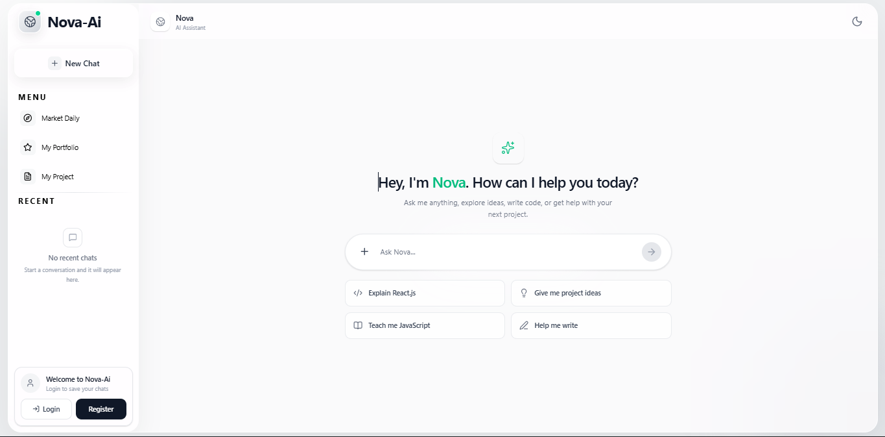
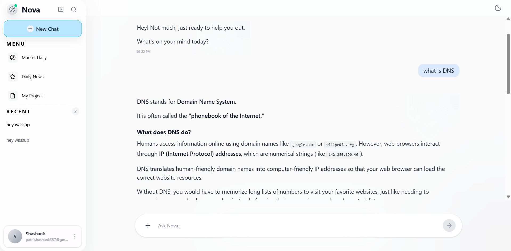

# 🤖 Nova AI – Intelligent AI Chatbot

<p align="center">
  
</p>

<p align="center">
  An intelligent, full-stack AI chatbot built with React, Node.js, Express, MongoDB, and Google's Gemini API.
</p>

<p align="center">
  <a href="https://ai-chatbot-kohl-six-88.vercel.app/"><strong>🚀 Live Demo</strong></a>
  &nbsp; | &nbsp;
  <a href="https://github.com/Shashannkkp/Ai-Chatbot"><strong>📂 GitHub Repository</strong></a>
</p>

---

## 📖 Overview

**Nova AI** is a full-stack AI-powered chatbot designed to provide intelligent, interactive, and user-friendly conversations.

The application integrates Google's Gemini API to generate AI responses and uses MongoDB Atlas to store user accounts and conversation history.

Users can register, log in, start new conversations, access previous chats, and manage their chat history through a responsive interface.

The project follows a separate frontend and backend architecture, with API endpoints deployed as Vercel serverless functions.

---

## 📸 Screenshots

### 🏠 Main Workspace

The Nova AI home screen featuring a clean interface and quick-start prompts.



### 💬 AI Conversation

The conversation interface displaying AI-generated responses and chat functionality.



---

## 📌 Table of Contents

- [Overview](#-overview)
- [Screenshots](#-screenshots)
- [Features](#-features)
- [Technology Stack](#-technology-stack)
- [Project Structure](#-project-structure)
- [Installation and Setup](#-installation-and-setup)
- [Environment Variables](#-environment-variables)
- [Running the Application](#-running-the-application)
- [API Endpoints](#-api-endpoints)
- [Deployment](#-deployment)
- [Security](#-security)
- [Future Improvements](#-future-improvements)
- [Author](#-author)

---

## ✨ Features

### 🤖 AI-Powered Conversations
- Generate intelligent responses using Google's Gemini API.
- Interact with AI through a simple chat interface.
- Support for Markdown-formatted responses.
- GitHub Flavored Markdown rendering.

### 🔐 Authentication
- User registration and login.
- JWT-based authentication.
- Secure password hashing using bcryptjs.
- Protected backend API operations.

### 💬 Chat Management
- Create new conversations.
- Save conversation history in MongoDB.
- Access previous conversations.
- Delete conversations.
- Automatically generate conversation titles.

### 🎨 User Interface
- Clean and modern chat interface.
- Responsive design.
- Quick-start prompts.
- Lucide React icons.
- Smooth and user-friendly interactions.

### ☁️ Deployment
- Frontend and backend deployed through one Vercel project.
- Serverless API functions.
- MongoDB Atlas database integration.
- Environment-based configuration.

---

## 🛠️ Technology Stack

### Frontend

| Technology | Purpose |
|---|---|
| React 19 | User interface |
| Vite | Frontend build tool |
| Tailwind CSS 4 | Styling |
| Lucide React | Icons |
| React Markdown | Markdown rendering |
| Remark GFM | GitHub Flavored Markdown |

### Backend

| Technology | Purpose |
|---|---|
| Node.js | JavaScript runtime |
| Express.js 5 | Backend framework |
| REST APIs | Client-server communication |
| JSON Web Token (JWT) | Authentication |
| bcryptjs | Password hashing |
| Google Gemini API | AI response generation |

### Database and Deployment

| Technology | Purpose |
|---|---|
| MongoDB Atlas | Cloud database |
| Mongoose | MongoDB object modeling |
| Vercel | Application deployment |
| Git & GitHub | Version control |

---

## 📂 Project Structure

```text
Ai-Chatbot/
│
├── api/
│   ├── auth.js
│   ├── chat.js
│   └── chats.js
│
├── backend/
│   ├── api/
│   │   ├── auth.js
│   │   ├── chat.js
│   │   └── chats.js
│   │
│   ├── lib/
│   ├── models/
│   ├── server.js
│   ├── package.json
│   └── .env
│
├── frontend/
│   ├── public/
│   ├── src/
│   ├── index.html
│   ├── vite.config.js
│   └── package.json
│
├── screenshots/
│   ├── UI1.png
│   └── Converstion.png
│
├── package.json
├── package-lock.json
├── vercel.json
├── .gitignore
└── README.md
```

---

## ⚙️ Installation and Setup

Follow these steps to run Nova AI locally.

### 1. Clone the Repository

```bash
git clone https://github.com/Shashannkkp/Ai-Chatbot.git
```

### 2. Navigate to the Project Directory

```bash
cd Ai-Chatbot
```

### 3. Install Dependencies

```bash
npm install
```

### 4. Configure Environment Variables

Create a `.env` file inside the `backend` directory.

Add the following environment variables:

```env
GEMINI_API_KEY=your_gemini_api_key
MONGODB_URI=your_mongodb_connection_string
JWT_SECRET=your_jwt_secret
```

See the [Environment Variables](#-environment-variables) section for details.

---

## 🔑 Environment Variables

| Variable | Description |
|---|---|
| `GEMINI_API_KEY` | Google Gemini API key |
| `MONGODB_URI` | MongoDB Atlas connection string |
| `JWT_SECRET` | Secret used to sign and verify JWT tokens |

**Important:** Never commit your `.env` file or expose your API keys and JWT secret in your GitHub repository.

---

## ▶️ Running the Application

Start the backend and frontend in separate terminals.

### Terminal 1 – Backend

```bash
npm run dev:backend
```

### Terminal 2 – Frontend

```bash
npm run dev:frontend
```

Open the local development URL displayed by Vite in your browser.

### Build for Production

```bash
npm run build
```

---

## 🔗 API Endpoints

The application uses REST API endpoints for authentication, AI conversations, and chat management.

| Method | Endpoint | Description |
|---|---|---|
| GET | `/` | Backend health/status |
| POST | `/api/auth` | User registration and login |
| POST | `/api/chat` | Generate AI responses |
| GET | `/api/chats` | Retrieve user's conversations |
| DELETE | `/api/chats` | Delete conversations |

---

## ☁️ Deployment

Nova AI is deployed using **Vercel**.

The frontend and backend API functions are hosted through a single Vercel project.

### 🌐 Live Application

<p align="center">
  <a href="https://ai-chatbot-kohl-six-88.vercel.app/">
    
  </a>
</p>

**Live URL:** https://ai-chatbot-kohl-six-88.vercel.app/

### Deployment Configuration

- **Platform:** Vercel
- **Framework:** Vite
- **Root Directory:** `.`
- **Build Command:** `npm run build`
- **Output Directory:** `frontend/dist`

Configure the following environment variables in Vercel:

- `GEMINI_API_KEY`
- `MONGODB_URI`
- `JWT_SECRET`

---

## 🔒 Security

- Passwords are hashed using bcryptjs.
- JWT is used for authentication.
- Protected API operations require valid authentication.
- Environment variables are used to store sensitive configuration.
- Database access is handled through MongoDB and Mongoose.

---

## 🚀 Future Improvements

- Streaming AI responses.
- Support for multiple AI models.
- Chat search functionality.
- Export conversations.
- Voice input and output.
- Additional customization options.

---

## 👨‍💻 Author

<p align="center">
  <strong>Shashank Patel</strong>
</p>

<p align="center">
  Software Engineer | Full Stack Developer
</p>

<p align="center">
  <a href="https://github.com/Shashannkkp">
    
  </a>
</p>

---

<p align="center">
  ⭐ If you like this project, consider giving it a star!
</p>

<p align="center">
  Made with ❤️ by Shashank Patel
</p>